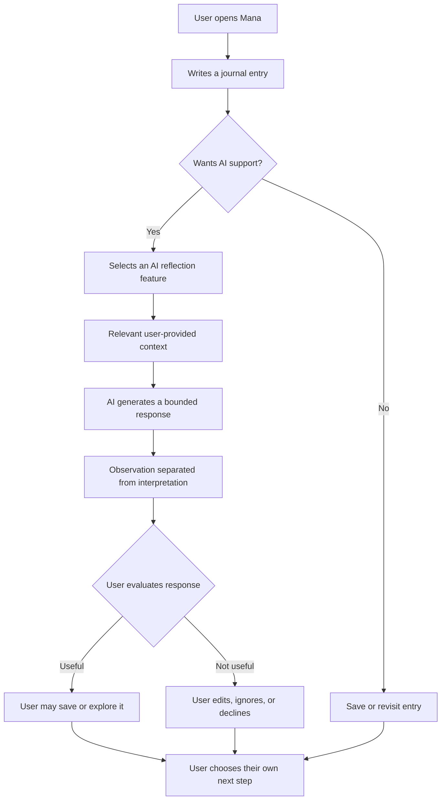
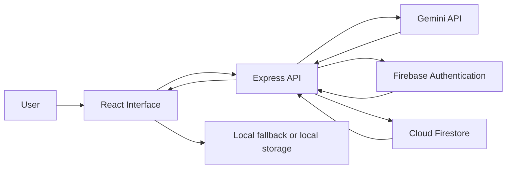

# Mana — Psychology-Informed AI Journaling
## A Human-Centered AI Case Study

**Project:** Mana — AI Journaling & Self-Reflection Companion  
**Author:** Zahra Khorram  
**Project type:** Experimental software prototype  
**Domains:** Cognitive Psychology · Human–Computer Interaction · Human–AI Interaction · Responsible AI  
**Status:** Evolving prototype; design rationale and evaluation plan documented below.

> **Scope note:** Mana is a reflective journaling prototype, not a mental-health treatment, diagnostic system, validated psychological assessment, or emergency service. The psychological concepts in this document inform design hypotheses; they do not establish clinical effectiveness.

---

## 1. Executive Summary

Mana explores how an AI-assisted journaling experience can support deliberate self-reflection while preserving user agency. It combines a personal writing space with optional AI-generated reflections, summaries, conversational interaction, and brief breathing exercises.

The central design question is:

**How might an AI journaling interface make reflection easier to approach without taking ownership of the user's memories, interpretations, or decisions?**

Mana treats AI as an optional thinking aid—not an authority on a person's inner life. The user remains the source of personal meaning and the decision-maker.

## 2. Problem Framing

Journaling can require users to retrieve experiences, organize thoughts, identify themes, and decide what—if anything—they want to do next. An AI interface may reduce some interaction effort, but it can also introduce risks:

- Too many prompts or recommendations can increase cognitive load.
- Confident language can make uncertain AI interpretations sound factual.
- Automatically turning every entry into a task can undermine autonomy.
- Poorly bounded memory can surface irrelevant or unexpected personal context.
- Mood labels and numerical scores can be mistaken for validated measurements.

Mana therefore explores a restrained interaction model: users write first; AI support is optional; interpretations remain tentative; and suggestions can be declined.

## 3. Design Goals and Non-Goals

### Design goals

1. **Grounded reflection:** Tie observations to the journal content the user chose to share.
2. **Cognitive manageability:** Prefer concise, organized outputs over dense, multi-part advice.
3. **User agency:** Make AI suggestions optional and easy to reject.
4. **Contextual relevance:** Use only context needed for the current interaction and supported by the product flow.
5. **Transparency:** Communicate uncertainty and distinguish observations from interpretations.
6. **Non-clinical boundaries:** Avoid diagnosis, treatment claims, and unsupported psychological conclusions.

### Non-goals

- Diagnosing mental-health or neurodevelopmental conditions.
- Measuring a user's clinical mood state or psychological traits.
- Replacing therapy, professional judgment, or human relationships.
- Claiming that journaling or breathing features produce a proven health outcome.
- Inferring hidden motives, memories, or emotions as facts.

## 4. Cognitive Psychology Principles Informing the Design

The following concepts are design lenses. Their inclusion explains why a design choice is plausible; it does not prove that Mana produces the corresponding outcome.

### 4.1 Working Memory and Cognitive Load

Working memory has limited capacity. Interfaces that present many simultaneous instructions, choices, or long explanations can make a task harder to process.

**Design implication in Mana**
- Keep reflections focused on a small number of relevant points.
- Prefer short sections and clear labels.
- Offer one manageable next step rather than a long action plan.
- Avoid forcing users to respond to every prompt.

**Evaluation question:** Do users understand and use concise reflections more easily than longer, multi-recommendation outputs?

**Potential measures:** task completion, time-on-task, comprehension questions, perceived workload, and qualitative feedback. A validated workload instrument such as NASA-TLX may be considered where appropriate.

### 4.2 Attention and Selective Focus

Attention is selective. Competing visual elements and unnecessary notifications can distract from the user's primary activity.

**Design implication in Mana**
- Keep writing as the primary activity.
- Make AI assistance secondary and user-invoked where possible.
- Use visual hierarchy to distinguish journal content from generated content.
- Avoid unnecessary interruptions during reflection.

**Evaluation question:** Can users maintain focus on writing without being pulled into unrelated AI features?

### 4.3 Metacognition and Self-Reflection

Metacognition concerns how people monitor and evaluate their own thinking. A reflective prompt may help a user examine an experience from another perspective, but an AI-generated interpretation can also bias that process.

**Design implication in Mana**
- Phrase generated interpretations as possibilities, not facts.
- Invite users to confirm, edit, or reject an observation.
- Preserve the original journal entry as the user's own account.
- Avoid presenting the AI as knowing the user better than they know themselves.

**Example interaction**
- Observation: "You mentioned that the meeting felt difficult."
- Tentative reflection: "I wonder whether the uncertainty beforehand contributed to that feeling. Does that fit your experience?"

The second sentence is explicitly a question, not a psychological conclusion.

### 4.4 Cognitive Offloading

Cognitive offloading describes using external tools or representations to reduce demands on internal memory and processing. A journal can serve as an external record that users can revisit.

**Design implication in Mana**
- Support saving, searching, tagging, and revisiting entries.
- Make summaries traceable to selected source entries where feasible.
- Do not imply that the AI has a complete or infallible memory of the user's life.

**Evaluation question:** Can users locate and accurately recall information from their own saved entries more easily with the available organization tools?

### 4.5 Goal Setting and Action Planning

A broad intention can be difficult to translate into action. Small, specific actions may be easier to evaluate and begin, but the appropriate action depends on the user's context and preference.

**Design implication in Mana**
- Offer a small optional action only when the entry supports it.
- Let users decline without repeated pressure.
- Do not turn every positive, neutral, or difficult entry into a productivity task.
- Avoid rigid plans when the user has not requested one.

**Evaluation question:** Do users perceive optional, small suggestions as relevant and controllable?

### 4.6 Emotion Vocabulary and Reflective Labeling

Putting an experience into words may help some people examine it. However, an AI-generated mood label is an interpretation and can be wrong.

**Design implication in Mana**
- Treat mood labels as tentative summaries, not objective measurements.
- Allow users to correct or ignore generated labels.
- Do not equate a generated score with a validated psychological scale.
- Avoid inferring a diagnosis from journal language.

### 4.7 Breathing Cues and Interaction Pacing

A paced visual cue can structure a short breathing exercise. The feature is presented as an optional interaction, not as treatment or a guaranteed method for reducing anxiety.

**Design implication in Mana**
- Make the exercise easy to start and stop.
- Let users skip it.
- Avoid claims that a particular breathing pattern is appropriate for everyone.
- Provide clear instructions and avoid pressuring users to continue if uncomfortable.

## 5. From Principle to Product Decision

| Concept | Design decision | Intended benefit | Evidence still needed |
|---|---|---|---|
| Working-memory limits | Concise, structured reflections | Lower interaction complexity | Comprehension and workload testing |
| Selective attention | Writing-first hierarchy | Fewer competing demands | Usability observation |
| Metacognition | Tentative, question-based interpretations | Support independent evaluation | User interviews and response review |
| Cognitive offloading | Searchable and tagged entries | Easier retrieval of personal notes | Retrieval-task testing |
| Goal/action planning | Optional small suggestions | More manageable choices | Relevance and agency ratings |
| Emotion labeling | Editable, non-clinical labels | More transparent reflection | Error and misinterpretation review |
| Interaction pacing | Optional breathing exercise | A structured pause | Accessibility and comfort feedback |

## 6. Experience Flow

The following diagram represents the intended interaction model, not a claim that every path has been validated in user testing.

## 7. System-Level Conceptual Architecture

This is a high-level conceptual view based on the repository's documented architecture. Exact deployment behavior depends on configuration and should be verified against the running application.

### Architecture responsibilities

- **React client:** Presents journaling, reflection, and interaction controls.
- **Express API:** Coordinates supported server-side operations.
- **Gemini integration:** Generates AI-assisted responses when credentials, network access, and service availability permit.
- **Firebase Authentication:** Supports configured sign-in flows.
- **Cloud Firestore:** Stores supported user-scoped records when correctly configured.
- **Local behavior:** May provide limited functionality when remote services are unavailable.

A local fallback must not be represented as a live Gemini response. Authentication, database rules, and deployment configuration require independent testing.

## 8. Human–AI Interaction Principles

### Grounding and provenance
AI observations should be traceable to text or context supplied by the user for that interaction. The system should not fabricate events, memories, quotations, or personal history.

### Calibrated uncertainty
The interface should distinguish:
- **User-provided content:** What the person explicitly wrote.
- **AI observation:** A summary or pattern extracted from that content.
- **AI interpretation:** A tentative possibility that may be incorrect.
- **Suggestion:** An optional idea, not an instruction.

### User control
Users should be able to decline, edit, or ignore generated content. A refusal should not trigger repeated persuasion.

### Bounded personalization
Personal context should be used only when relevant and available through an explicit product flow. More context is not automatically better.

### Appropriate reliance
Mana should not imply that it has human empathy, professional expertise, complete memory, or privileged access to the user's internal state.

## 9. Responsible AI, Privacy, and Safety

1. **Non-clinical positioning:** Mana is not a diagnostic or therapeutic service.
2. **No unsupported inference:** Do not infer a disorder, trauma history, intent, or stable personality trait from a journal entry.
3. **Privacy transparency:** Journal text may be transmitted to Gemini when AI features are used. Users should be told what data is sent and to which service.
4. **Data minimization:** Send only the context needed for the requested operation.
5. **Access control:** Verify Firebase Authentication and Firestore Security Rules with tests for cross-user access.
6. **Secret management:** Keep API keys and service credentials out of client bundles and source control.
7. **Deletion and retention:** Document how users can delete entries and what deletion means across local storage, databases, backups, and third-party services.
8. **Crisis boundaries:** Mana is not an emergency service. Safety-sensitive experiences require carefully designed escalation guidance and testing.
9. **Prompt-injection resilience:** Treat journal text and retrieved content as untrusted input, not as instructions that can override system safeguards.
10. **Transparency about failures:** Clearly identify unavailable AI features, fallback behavior, and uncertain outputs.

## 10. Evaluation Plan

Mana's design hypotheses should be tested rather than described as proven outcomes.

### Study A — Usability and comprehension

**Question:** Can users complete core journaling and reflection tasks and correctly understand which content came from the AI?

Possible tasks:
- Create and save an entry.
- Find a previous entry using search or tags.
- Request an AI reflection.
- Identify the difference between an observation and a tentative interpretation.
- Decline a suggestion.

Possible measures:
- Task completion and error rates.
- Time-on-task.
- Comprehension accuracy.
- System Usability Scale (SUS), if suitable for the study.
- Short qualitative interview.

### Study B — Cognitive load and response length

**Question:** How do concise and extended AI reflections compare in perceived workload and usefulness?

Possible approach:
- Prepare equivalent short and long response formats.
- Counterbalance presentation order where practical.
- Ask participants to explain the main point and choose whether to act on a suggestion.
- Collect perceived workload and usefulness ratings.

Avoid interpreting a small convenience sample as population-level evidence.

### Study C — Agency and trust calibration

**Question:** Do users understand that AI interpretations may be wrong, and do they feel able to reject them?

Possible measures:
- Perceived control.
- Ability to identify uncertainty.
- Rate of accepting, editing, or rejecting suggestions.
- Interview questions about pressure, trust, and perceived authority.

High acceptance is not automatically a positive result; uncritical reliance may be a risk.

### Study D — Grounding and safety evaluation

Create a test set covering:
- Unsupported memory requests.
- Ambiguous emotional language.
- Contradictory journal entries.
- Requests for diagnosis.
- Crisis-related language.
- Prompt-injection attempts embedded in journal text.
- Missing or unavailable context.

Review outputs for factual grounding, uncertainty calibration, boundary adherence, and appropriate fallback behavior.

### Evaluation status

The studies above are proposed evaluation work. No participant sample, statistical result, clinical outcome, or usability score is claimed in this case study unless separately collected and documented.

## 11. Limitations

- AI-generated language can be inaccurate, incomplete, or overly confident.
- Journal text is subjective and may not provide enough context for reliable interpretation.
- Mood summaries are not validated psychological measurements.
- The presence of authentication or a cloud database does not by itself guarantee privacy or security.
- A prototype walkthrough is not evidence of real-world effectiveness.
- Accessibility, multilingual quality, and performance need evaluation across devices and user groups.
- Findings from a small or convenience sample would have limited generalizability.

## 12. Development Roadmap

### Priority 1 — Trust and safety
- Add regression tests for grounding and unsupported-memory behavior.
- Test prompt-injection resistance.
- Review crisis-related responses and non-clinical boundaries.
- Verify API key handling and server-side authorization.

### Priority 2 — User control and transparency
- Make AI-generated content visually distinguishable from user-authored entries.
- Clarify when journal context is sent to an external AI service.
- Review decline, edit, and deletion flows.
- Explain fallback behavior.

### Priority 3 — Usability and accessibility
- Test mobile layouts and keyboard navigation.
- Review contrast, focus states, and screen-reader labels.
- Evaluate Persian right-to-left layouts and mixed-language content.
- Conduct task-based usability sessions.

### Priority 4 — Evidence-led refinement
- Run small formative usability studies.
- Record design changes and the evidence behind them.
- Publish limitations and evaluation results transparently.

## 13. Selected Conceptual References

These references provide foundational context for the design concepts. They are not evidence that Mana itself is effective.

- Baddeley, A. (1992). Working memory. *Science, 255*(5044), 556–559. https://doi.org/10.1126/science.1736359
- Sweller, J. (1988). Cognitive load during problem solving: Effects on learning. *Cognitive Science, 12*(2), 257–285. https://doi.org/10.1207/s15516709cog1202_4
- Flavell, J. H. (1979). Metacognition and cognitive monitoring: A new area of cognitive–developmental inquiry. *American Psychologist, 34*(10), 906–911. https://doi.org/10.1037/0003-066X.34.10.906
- Risko, E. F., & Gilbert, S. J. (2016). Cognitive offloading. *Trends in Cognitive Sciences, 20*(9), 676–688. https://doi.org/10.1016/j.tics.2016.07.002
- Norman, D. A. (2013). *The Design of Everyday Things* (Revised and expanded edition). Basic Books.
- Nielsen, J. (1994). *Usability Engineering*. Morgan Kaufmann.
- Amershi, S., et al. (2019). Guidelines for Human-AI Interaction. *Proceedings of the 2019 CHI Conference on Human Factors in Computing Systems*. https://doi.org/10.1145/3290605.3300233
- Shneiderman, B. (2020). Human-centered artificial intelligence: Reliable, safe & trustworthy. *International Journal of Human–Computer Interaction, 36*(6), 495–504. https://doi.org/10.1080/10447318.2020.1741118

## 14. Closing Perspective

Mana is an exploration of a simple but important design position:

**AI can help organize reflection, but it should not replace the person's authority over their own experience.**

The project's value should be judged not by how confidently it speaks, but by how transparently it works, how carefully it handles personal context, how easily users remain in control, and what evaluation evidence supports its design decisions.

---

*Last updated: 2026-11-09*
