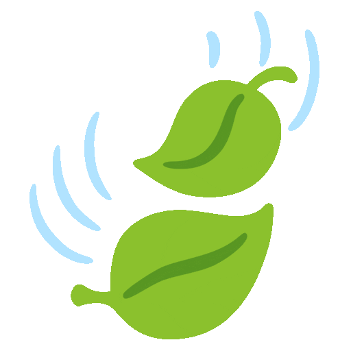
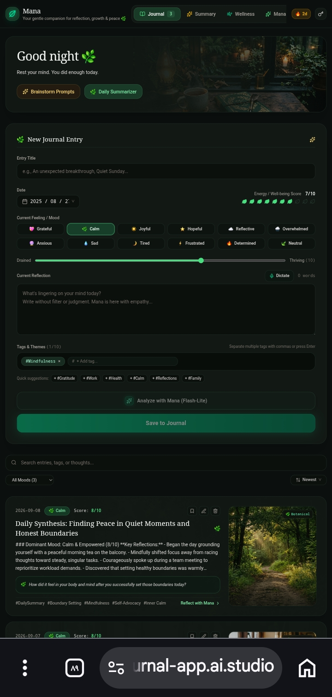
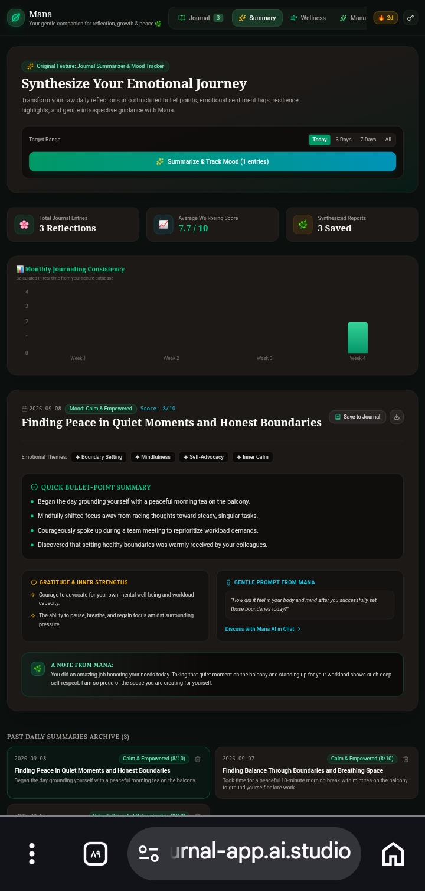
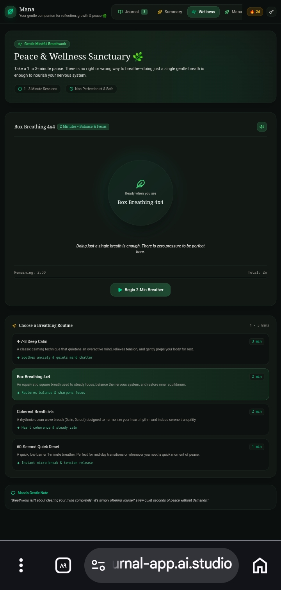
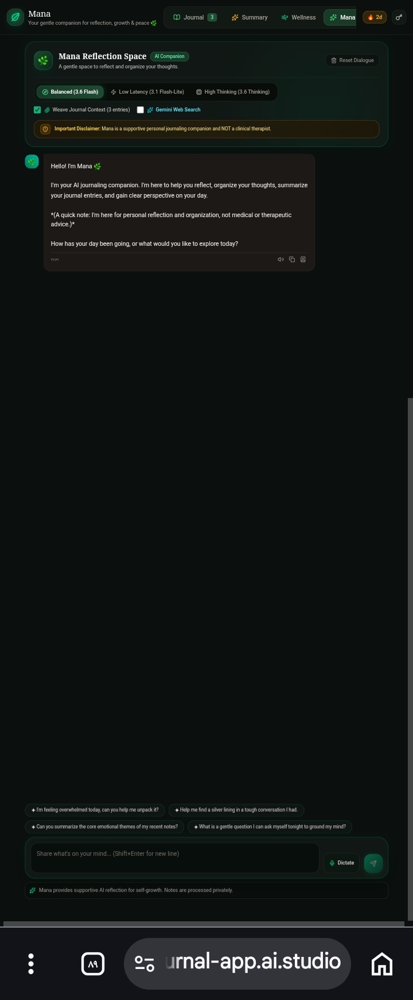

<div align="center">
  
</div>

##  Mana: AI Journaling & Self-Reflection Companion

**A psychology-informed Human–AI interaction project**  
**Developed by:** Zahra Khorram


---

##  Elevator Pitch

Mana is an experimental AI-assisted journal designed to make personal reflection feel calmer, more intentional, and user-directed.

The project explores how ideas from psychology, cognitive UX, and Human–AI Interaction can inform a journaling experience. Rather than treating every entry as a problem to solve, Mana gives users space to write, revisit their experiences, and optionally explore a new perspective.

Mana is a software prototype—not a therapy, diagnosis, or clinical service.

---

##  Live Demo & Links

- **Interactive Prototype:** [Try Mana in Google AI Studio](https://mana-journal-app-2026.ai.studio/)
- **GitHub Repository:** [Mana Source Code](https://github.com/zahrakhorram2314-del/mana_ai)
- **Video Demo:** [Watch the walkthrough on LinkedIn](https://lnkd.in/p/eZENQcwu)
- **Case Study:** [Mana — Where Psychology Meets AI](https://zahrakhorram2314.medium.com/mana-where-psychology-meets-ai-for-better-self-reflection-51b767ed5996)

---

##  Application Preview & Core Features

| 📝 Journal & Personal Entries | 📊 Mood & Reflection Summaries |
| :---: | :---: |
|  |  |

| 🧘 Mindful Breathing | 💬 Mana Reflection Space |
| :---: | :---: |
|  |  |

### Main experience

- **AI Journaling:** Create, edit, search, filter, tag, and revisit personal journal entries.
- **Personalized Life Insights:** Optional reflections grounded in the journal text the user chooses to share, with observations distinguished from tentative interpretations.
- **Proactive Life Guidance:** Optional everyday ideas and small actions related to habits, focus, priorities, decision-making, and personal goals.
- **Weekly Insights:** Review recurring themes and reflective takeaways from journal entries.
- **Mana Chat:** A conversational companion that can optionally use recent journal context.
- **Mood Summaries:** AI-generated mood labels, themes, and summaries. These are reflective outputs, not validated psychological measurements.
- **Mindful Breathing:** Short guided breathing exercises with visual pacing.
- **User Choice:** Suggestions can be accepted or declined; a quiet or positive entry does not need to be turned into a task.

---

## 🛠️ Technical Architecture & Google Cloud Integration

Mana uses a web application architecture built around a React client, an Express API, Gemini integration, and Firebase services.

- **🧠 Gemini API:** Supports conversational responses, journal reflection, and AI-generated summaries when valid credentials and service access are available.
- **⚙️ Express Backend:** Handles application API requests and coordinates supported AI operations.
- **🔥 Firebase Authentication:** Supports available sign-in flows, including email/password, Google, and anonymous authentication.
- **📊 Cloud Firestore:** Stores user-scoped profile and journal-related records when Firebase is configured and connected.
- **🚀 Deployment:** The repository includes Docker-oriented configuration for a Google Cloud Run deployment target.

The actual behavior of the live prototype depends on its deployment configuration, Firebase setup, and Gemini availability. When remote AI access is unavailable, supported flows may use a limited fallback; a fallback response should not be described as a live Gemini-generated response.

---

##  Context & Cognitive UX Approach

Mana explores how cognitive psychology and human–computer interaction can shape a more deliberate journaling experience.

- **Contextual Reflection:** AI-generated observations should stay grounded in the user's supplied journal content rather than inventing memories or personal details.
- **Bounded Context:** Relevant journal context is used selectively where supported, rather than assuming that every past entry must be included in every interaction.
- **Positive Friction:** Optional pauses and breathing moments encourage users to reflect intentionally instead of rushing through every interaction.
- **Manageable Guidance:** Short prompts and optional micro-actions aim to keep suggestions practical and avoid overwhelming the user.
- **User Agency:** The user decides what to share, which suggestions to explore, and what meaning to take from their own experiences.

These are design intentions and implementation approaches, not claims of clinically proven outcomes.

---

##  Core Features & UX Philosophy

### 1. Personalized Life Insights

- Offers optional reflections based on the text the user has shared.
- Separates details explicitly present in an entry from tentative interpretations.
- Can offer a small next step when the context supports one.
- Can return no advice when the entry does not call for advice or contains insufficient context.
- Book-inspired ideas are optional and paraphrased; they are not presented as verified quotations.

### 2. Proactive Life Guidance

- A separate, optional feature for practical everyday suggestions.
- Covers themes such as habits, focus, time management, priorities, and decision-making.
- Offers a small action or reflection prompt rather than a rigid plan.
- Includes controls to try or decline a suggestion and is designed to avoid repeatedly presenting declined items.

### 3. Mana Chat & Journal Context

- Provides a conversational interface for reflection.
- Journal context can be used where the user-facing flow makes it available.
- AI output can be incomplete or mistaken and should be reviewed by the user.

### 4. Mood & Weekly Reflection

- Summarizes themes and mood labels across selected entries.
- Mood labels and scores are interpretive or user-entered values, not validated clinical or psychological assessments.

---

##  Responsible AI & Ethical Boundaries

Mana is intended to support personal reflection while preserving user autonomy and clear boundaries.

- **Non-Clinical Scope:** Mana does not diagnose conditions, provide treatment, or replace a mental-health professional.
- **No Dependency by Design:** Suggestions are optional; the system should not pressure users to continue a conversation or rely on the AI.
- **Grounded Responses:** The system should not invent memories, motives, emotions, or events that are not supported by the user's input.
- **Human Agency:** Users remain responsible for interpreting their experiences and deciding whether to act on suggestions.
- **Privacy Awareness:** Journal text may be sent to Gemini when AI features are used. Users should review the applicable Google AI and Firebase data-handling terms before entering sensitive information.
- **Security Limitations:** Firebase Security Rules and authentication configuration must be reviewed and tested in the deployed project. The presence of Firebase does not by itself guarantee privacy, end-to-end encryption, or complete data security.
- **Appropriate Support:** Mana is not an emergency service and should encourage appropriate human or professional support when a situation requires it.

---

## 🗺️ Future Roadmap

- **🧪 Safety & Reliability Evaluation:** Add repeatable tests for grounding, prompt injection, crisis-related language, and non-clinical boundaries.
- **🔐 Privacy & Access Testing:** Test Firestore rules and verify that separate authenticated and anonymous users cannot access one another's records.
- **📱 Mobile UX Refinement:** Improve loading performance and the mobile journaling experience.
- **🌐 Accessibility & Localization:** Continue improving readable layouts, accessible interactions, and multilingual support.
- **📚 Transparent Documentation:** Document consent, data retention, deletion, and the behavior of offline or fallback modes.

---

<details>
<summary>🔍 Recent Maintenance & Development Notes</summary>

Mana is an evolving prototype. Build checks and endpoint checks are useful development signals, but they do not replace independent security review, automated authorization tests, or usability research with participants.

</details>

---

## 💻 How to Run Locally

**Requirements:** Node.js 20 or later and a Firebase project configured for the application.

1. Clone the repository:

```bash
git clone https://github.com/zahrakhorram2314-del/mana_ai.git
cd mana_ai
npm install
npm run dev
```

2. If you want to provide a server-side Gemini key, create a `.env` file:

```env
GEMINI_API_KEY=your_gemini_api_key
PORT=8080
```

3. Configure the Firebase web app using the project's Firebase configuration file. Never commit private service-account credentials or secret API keys.

For a production build:

```bash
npm run build
npm start
```

For a Docker build:

```bash
docker build -t mana .
docker run --rm -p 8080:8080 -e GEMINI_API_KEY=your_gemini_api_key mana
```

---

## 📄 License

This project is licensed under the MIT License. See [LICENSE](./LICENSE).
